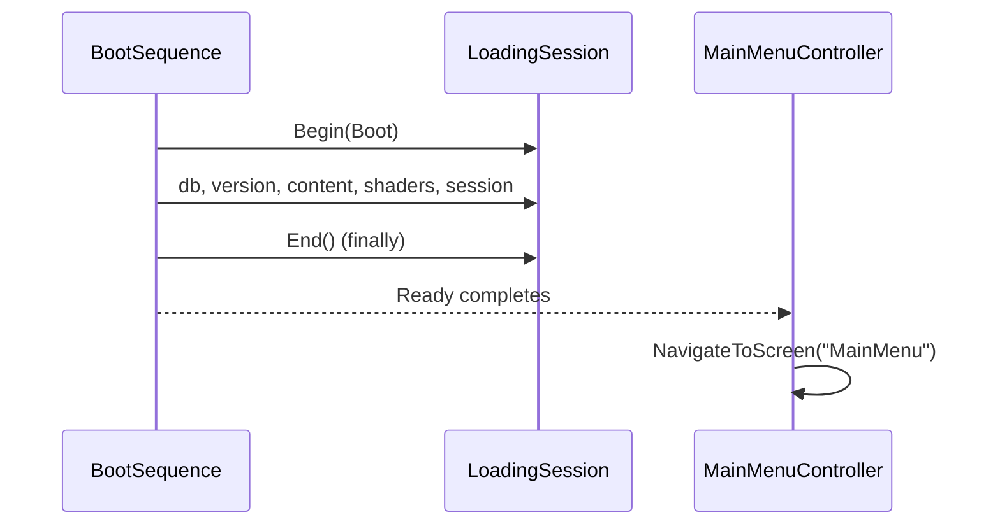

# Loading Screens

Every long wait in the client hides behind one full-screen loading splash: the painted title art, a progress bar, a phase label and a rotating tip. The screen is **presentation only**. It reports what the game is already doing and never decides anything.

Related: [Account Mode & Startup](?page=unity/19-account-mode-startup), [Open World](?page=unity/37-open-world).

## What the player sees

| Moment | Plan | Ends when |
|---|---|---|
| **Boot** (first frame to the main menu) | `Boot` | `BootSequence.Ready` completes; the menu then appears. |
| **Online entry** (Play Online, Link Email) | `OnlineEntry` | Connect, sign-in and content re-sync finish or fail. |
| **World entry** (character select to standing in the world) | `WorldEntry`, then `WorldReturn` after the prologue | The fader reveal after placement. |

Before the first frame, the **Unity splash** already shows the painted title art: a static composite (`Assets/CR/UI/Title/Splash/splash_background.png` + `splash_logo.png`) set as `PlayerSettings.SplashScreen` background and logo. The loading screen then picks up the same art, so the hand-off is seamless.

Door and whiteout relocations inside the world do **not** show the screen.

## Architecture

| Piece | File (under `Assets/CR/`) | Role |
|---|---|---|
| Screen | `UI/Loading/LoadingScreenController.cs`, `ILoadingScreen.cs`, `UI/Resources/LoadingScreen.uxml/.uss` | Renders a session. Flows only see `ILoadingScreen.Begin(plan)`. |
| Backdrop | `UI/Title/ParallaxLayerStack.cs` | The 14 painted title layers, extracted from `TitleBackdropController.cs` so the splash reuses them. |
| Theme | `UI/Theme/CrTheme.uss` (`--cr-loading-*` tokens) | All colours and sizes. Restyle via tokens, never per-screen literals. |
| Text | `UI/Text/LoadingText.cs` | Phase labels (`ui.loading.phase.*`) and 8 tips (`ui.loading.tip.1` to `8`). |
| Logic | `UI/Logic/Loading/*.cs` (asmdef `CR.UI.Logic`) | Pure, engine-free, unit tested. |

Pure logic types:

- `LoadingPhase`: a key plus a weight.
- `LoadingPlan` / `LoadingPlans`: an ordered list of phases. Plans: `Boot`, `OnlineEntry`, `WorldEntry`, `WorldReturn`. Phase keys are constants on `LoadingPlans` (`db`, `version`, `catalog`, `content`, `shaders`, `session`, `connect`, `signin`, `resolve`, `world`, `prologue`, `land`, `init`).
- `LoadingProgressModel`: a weighted, **monotonic** bar. It never goes backwards, whatever order flows report in.
- `LoadingSession`: the flow's handle (`Phase`, `Report`, `Complete`, `End`). `End()` and `Dispose()` are idempotent and release the screen.
- `LoadingBarGlide`: the displayed value eases toward the model and creeps slowly when it stalls, so a long phase never looks frozen. It never creeps past the phase ceiling.
- `LoadingTipRotation`: tip order and timing.
- `ShaderWarmupBudget`: adaptive per-frame work batch for warm-up.

**Server-authoritative rule.** The screen takes no input and writes no game state. Flows report progress they already observe (a sync event, a scene load, a world-init count). Nothing here awards, grants or resolves anything, so it fits the rule that the client is presentation. Bindings are in `Core/DI/LocalDevGameInstaller.cs` (search "Loading screens"); the controller and `ShaderWarmup` are bound `.NonLazy()`.

## Boot sequence

`Core/Boot/BootSequence.cs` walks the `Boot` plan, then completes `Ready`:

1. `Database`: waits `DbReadyGate`.
2. `Version`: waits `GameSessionManager.VersionChecked` (timeout 8 s).
3. `Content`: waits content sync (`ContentSyncReady`). Progress comes from `IContentSyncProgressSource` events raised by `ContentRegistryInitializer`; `ServerContentSyncService.SyncAllAsync` takes `IProgress<ContentSyncProgress>`, and `ContentSyncPhaseMap` maps those events to phase keys. Budget: 20 s, capped by the shared 25 s network budget minus the time the version check took.
4. `Shaders`: `IShaderWarmup.WarmAsync` (see below). Cancels on destroy.
5. `Session`: waits `GameSessionManager.Ready` (timeout 10 s).

Timeouts live in `Core/Boot/BootTimeouts.cs`. A timed-out network phase moves on; the sync keeps running in the background. A fault anywhere is logged and boot continues. The whole walk is in a `try/finally` that ends the session and completes `Ready`, so the player is never trapped.

`MainMenuController` waits on `BootSequence.Ready` before `NavigateToScreen("MainMenu")`. The log line `[Boot] db .. version .. content .. shaders .. session .. total` gives per-phase timings.

## Online entry

`MainMenuController` runs an `OnlineEntry` session (`Connect`, `SignIn`, `Content`) for Play Online and Link Email, replacing the old status label. The `status-message` label stays as the fallback: it shows errors once the screen has faded.

## World entry

`Game/OpenWorld/OpenWorldBootstrap.cs` owns the session:

- **Show:** at placement it begins `WorldEntry` (`Resolve`, `World`, `Prologue`, `Land`, `WorldInit`). A session already up carries on across the placement's steps.
- **Prologue:** the session is hidden **before** the prologue room is revealed, so the Earth room is never covered. The placement after the prologue shows `WorldReturn` (`Land`, `WorldInit`).
- **World-init wait:** before the teleport the bootstrap waits for `GameInitializer`'s run through `Game/World/IWorldInitProgress.cs` / `WorldInitProgress.cs` (counter in `Logic/WorldInitProgressCounter.cs`). The wait is bounded by `worldInitWaitSeconds` (default 20 s); on expiry it logs a warning and reveals anyway.
- **Hide:** after the fader reveal.

Only placements show the screen; door and whiteout relocations do not.

## Shader warm-up

`Core/Rendering/ShaderWarmup.cs` compiles the shaders the game is known to use before they are first drawn. It starts at boot (its own `Start` calls `Begin()`), runs once per launch, and publishes `ShaderWarmupProgress` (`Done`/`Total`, `ProgressChanged`, `Completion`). Two sources, two mechanisms:

1. **Unity 6 GraphicsStateCollection** traces per platform and graphics API, at `StreamingAssets/CR/Shaders/pso-<Platform>-<API>.graphicsstate`. These warm through Unity's warm-up **job** (`GraphicsStateCollection.WarmUp()` returns a `JobHandle`): worker threads do the pipeline creation, the main thread only polls `completedWarmupCount` once a frame. Record: launch a player with `-crPsoTrace` (or env `CR_PSO_TRACE=1`), play the title, the world and a battle, quit (the file lands in `persistentDataPath/Shaders/`), then `unity cmd --project-path <proj> cr_pso_import --args <path>`. A trace is only used when its platform and API match the running player.
2. **ShaderVariantCollection** at `Resources/Shaders/CrShaderVariants`, the fallback where no trace ships. Unity has no job for it, so it is sliced across frames with an adaptive batch (`ShaderWarmupBudget`). Record in the Editor: play through the game, then `cr_shader_variants_save` (or menu CR / Rendering / Save Tracked Shader Variants; `cr_shader_variants_status`, `cr_shader_variants_clear`). Save **merges**: it adds only variants the asset lacks (`ShaderVariantMerge`), so each session need not cover everything and a short session never shrinks the recording. `--args replace` overwrites instead.

**Explicit first run, background afterwards** (`ShaderWarmupGate`, pure, tested). The first launch of a build on a given GPU/API holds the boot splash on "Compiling shaders n/m" until the run ends, capped at `HoldCapSeconds` (90 s). A complete run writes a PlayerPrefs marker keyed by build version + API + device; a stalled or skipped run does not, so the next launch repeats the explicit step. Every later launch starts the same run in the background and shows the menu at once; the title screen carries the counter (`shader-status` label, `ui.loading.shaders-counter`) until it finishes. This mirrors what Steam does outside the process with its Vulkan shader pre-caching (Fossilize replay before launch): the game cannot upload to that system, it only benefits from shipping Vulkan on Linux and keeping variants stable between builds.

**Run loop and testing.** The loop lives in `ShaderWarmupRunner` (no Unity types; sources behind `IVariantWarmSource` / `IGraphicsStateWarmSource`, real ones `VariantCollectionSource` / `GraphicsStateCollectionSource`), driven one `MoveNext` per frame by `ShaderWarmup`'s coroutine. `ShaderWarmupRunnerTests` drives it with fake sources and a fake clock: clean run, a throwing source (one warning, no per-frame retry), a job that will not start, a 10 s stall measured in time not frames, the job handle (not the count) deciding "done", and the job always joined.

**Runtime compile log.** After the warm-up ends, development builds (or a release build run with `-crLogShaderCompiles` / `CR_LOG_SHADER_COMPILES=1`) set `GraphicsSettings.logWhenShaderIsCompiled`, so Player.log lists every shader Unity still had to compile at runtime: that is the list the next recording or trace should cover (`ShaderCompileLogPolicy`).

Other files: `ShaderWarmupPaths.cs`, `ShaderWarmupSummary.cs`, `PsoTraceRecorder.cs`, `Editor/ShaderVariantCommands.cs`, `UI/Logic/Loading/ShaderWarmupProgress.cs`, `ShaderWarmupGate.cs`.

**Build-time variant stripping** (`Editor/ShaderVariantStripper.cs`, an `IPreprocessShaders`; rules in `ShaderVariantStripPolicy.cs`). For every shader the recorded collection covers, keyworded variants the game was never seen to use are dropped from the player: less to compile on first launch, smaller build, and a shipped set that no longer drifts between builds. Shaders the recording never saw are left whole, and the keyword-less variant is always kept. It is **report-only by default**: every build logs one `[ShaderStrip]` line ("would strip N of M variants across K shaders") plus the heaviest shaders; set `CR_SHADER_STRIP=1` in the build environment to strip for real. Turn it on only after a recording that covers the title, the world, a battle and the interiors, otherwise a biome or an effect the recording missed ships pink.

### Recording the Steam Deck's Vulkan PSO trace

A PSO trace is only recorded, and only used, when the player runs Vulkan. A Linux player built from `feat/linux-vulkan-first` onward is Vulkan-first (see "Linux graphics APIs" in the Standalone Builds page), so the Deck now qualifies. Before that change the Deck ran OpenGL Core and the warm-up logged `OpenGLCore has no PSO trace support`.

**Record**

1. Deploy a build to the Deck (CR > Build > Deploy to Steam Deck…). Check the Deck's Player.log says it is on Vulkan; the log report's "Graphics API" line shows this.
2. In Steam, open the game's Properties > Launch Options and set `-crPsoTrace` (the environment variable `CR_PSO_TRACE=1` does the same). Add `-crHitchLog` if the build is not a development build and you also want the `[Perf]` lines.
3. Launch from Game Mode. On the first launch with a new graphics API the boot splash holds on "Compiling shaders" (up to 90 s). Let it finish.
4. Play what the trace should cover: the title screen, walk each area, open the bag and party screens, and start a battle with each kind of attack effect. Any pipeline not drawn during the session is not in the trace and will compile (and hitch) the first time a player meets it.
5. Quit cleanly: Steam menu > Exit Game, or the in-game quit. Killing the process or letting the Deck sleep and then force-closing means the trace is never written.
6. Check Player.log for `[PsoTrace] recording; will write '...pso-LinuxPlayer-Vulkan.graphicsstate' on quit.` near the start and `[PsoTrace] saved N graphics states, M variants to '...'` at the end. No `saved` line means no file.

The file is written to `~/.config/unity3d/CR/Crystalline Rift/Shaders/pso-LinuxPlayer-Vulkan.graphicsstate` on the Deck.

**Fetch and import**

- In the Editor: CR > Build > Deploy to Steam Deck…, then **Fetch PSO trace from the Deck**. It copies the file with `scp -O` to a temporary folder, then imports it through `cr_pso_import` into `Assets/StreamingAssets/CR/Shaders/`.
- Headless: `ci/deck-pso-fetch.sh <deck-ip>` from the project root does the same and prints the next steps. Add `--dry-run` to see the exact commands without running anything.
- By hand: `unity cmd --project-path <proj> cr_pso_import --args <path to the file>`.

`cr_pso_import` and both fetch paths accept only a file named `pso-<Platform>-<GraphicsApi>.graphicsstate` (for example `pso-LinuxPlayer-Vulkan.graphicsstate`); any other name is refused. An EditMode test (`PsoTraceFilesTests`) fails if a badly named `.graphicsstate` file is ever left in `Assets/StreamingAssets/CR/Shaders`.

**Ship it.** Let Unity import the file (it writes the `.meta`), commit both, and rebuild the Linux player. The next Deck log should show `[ShaderWarmup] warm-up done: N/N variants, M/M graphics states` with M above zero and no `no PSO trace` warning.

**Caveat: the warm-up marker.** The "completed a warm-up" marker (`ShaderWarmupGate.MarkerKey`) is keyed by the warm-up set (Unity version plus shader and variant counts), the graphics API and the device. It does not include the trace. A device that already finished a warm-up for that set and API will therefore not hold the boot splash again when a trace is added to a later build; the trace is still warmed, but in the background behind the menu. To see the explicit first-run splash again on a test Deck, delete the `cr.shaders.warmed.*` keys from the game's PlayerPrefs file (`~/.config/unity3d/CR/Crystalline Rift/prefs`) or test on a fresh install.

**Reading the result.** `ci/deck-fetch-log.sh <deck-ip>` copies the whole Player.log to `DeckLogs/`; `cr_deck_log_report --args <file>` then prints PASS / WARN / FAIL lines for the shader checks (see "Testing on the Steam Deck" in the Standalone Builds page).

## Adding a phase

1. Add a key constant and a `LoadingPhase(key, weight)` to the right plan in `UI/Logic/Loading/LoadingPlans.cs`. Weights are relative within the plan.
2. Add a `LocString` label (`ui.loading.phase.<key>`) in `UI/Text/LoadingText.cs` and map it in `LoadingText.For`.
3. Report from the flow: `session.Phase(key)`, then `Report(fraction)`; `Complete(key)` when done.
4. Add the label to the AI content ledger and any localization pack.
5. Extend `LoadingPlanTests` if the plan shape matters.

Always end the session in a `finally`.

## Tests

In `UI/Logic/Tests/` (EditMode, `CR.UI.Logic`): `LoadingPlanTests`, `LoadingProgressModelTests`, `LoadingSessionTests`, `LoadingBarGlideTests`, `LoadingTipRotationTests`, `ShaderWarmupBudgetTests`.

## Troubleshooting

- **Screen never fades.** Every flow ends its session in `finally` (`BootSequence`, `OpenWorldBootstrap.HideEntryLoading`). Look for a new path that begins a session without ending it; prefer `using` since `Dispose()` ends it.
- **Bar looks frozen.** Check the phase is reporting; `LoadingBarGlide` creeps by design, but only up to the phase ceiling. A phase that never calls `Report` or `Complete` stalls there.
- **Bar jumps ahead then waits.** Expected: the model is monotonic and weights are relative.
- **No shader work happens.** The `CrShaderVariants` asset or the `pso-<Platform>-<API>.graphicsstate` file is missing for this platform. Record and import (see above). Warm-up failures are logged and skipped, never blocking.
- **Menu appears late on a bad network.** Boot waits at most the `BootTimeouts` budget, then moves on.
- **World reveal feels early.** Check the log for the `worldInitWaitSeconds` warning.
