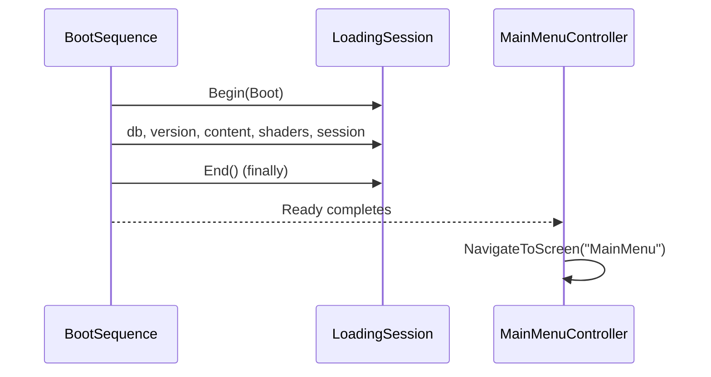

# Loading Screens

Every long wait in the client hides behind one full-screen loading splash: the painted title art, a progress bar, a phase label and a rotating tip. The screen is **presentation only**. It reports what the game is already doing and never decides anything.

Related: [Account Mode & Startup](?page=unity/19-account-mode-startup), [Open World](?page=unity/37-open-world).

## What the player sees

| Moment | Plan | Ends when |
|---|---|---|
| **Boot** (first frame to the main menu) | `Boot` | `BootSequence.Ready` completes; the menu then appears. |
| **Online entry** (Play Online, Link Email) | `OnlineEntry` | Connect, sign-in and content re-sync finish or fail. |
| **World entry** (character select to standing in the world) | `WorldEntry`, then `WorldReturn` after the prologue | The fader reveal after placement. |

Before the first frame, the **Unity splash** already shows the painted title art: a static composite (`Assets/CR/UI/Title/Splash/splash_background.png` + `splash_logo.png`) set as `PlayerSettings.SplashScreen` background and logo. The loading screen then picks up the same art, so the hand-off is seamless.

Door and whiteout relocations inside the world do **not** show the screen.

## Architecture

| Piece | File (under `Assets/CR/`) | Role |
|---|---|---|
| Screen | `UI/Loading/LoadingScreenController.cs`, `ILoadingScreen.cs`, `UI/Resources/LoadingScreen.uxml/.uss` | Renders a session. Flows only see `ILoadingScreen.Begin(plan)`. |
| Backdrop | `UI/Title/ParallaxLayerStack.cs` | The 14 painted title layers, extracted from `TitleBackdropController.cs` so the splash reuses them. |
| Theme | `UI/Theme/CrTheme.uss` (`--cr-loading-*` tokens) | All colours and sizes. Restyle via tokens, never per-screen literals. |
| Text | `UI/Text/LoadingText.cs` | Phase labels (`ui.loading.phase.*`) and 8 tips (`ui.loading.tip.1` to `8`). |
| Logic | `UI/Logic/Loading/*.cs` (asmdef `CR.UI.Logic`) | Pure, engine-free, unit tested. |

Pure logic types:

- `LoadingPhase`: a key plus a weight.
- `LoadingPlan` / `LoadingPlans`: an ordered list of phases. Plans: `Boot`, `OnlineEntry`, `WorldEntry`, `WorldReturn`. Phase keys are constants on `LoadingPlans` (`db`, `version`, `catalog`, `content`, `shaders`, `session`, `connect`, `signin`, `resolve`, `world`, `prologue`, `land`, `init`).
- `LoadingProgressModel`: a weighted, **monotonic** bar. It never goes backwards, whatever order flows report in.
- `LoadingSession`: the flow's handle (`Phase`, `Report`, `Complete`, `End`). `End()` and `Dispose()` are idempotent and release the screen.
- `LoadingBarGlide`: the displayed value eases toward the model and creeps slowly when it stalls, so a long phase never looks frozen. It never creeps past the phase ceiling.
- `LoadingTipRotation`: tip order and timing.
- `ShaderWarmupBudget`: adaptive per-frame work batch for warm-up.

**Server-authoritative rule.** The screen takes no input and writes no game state. Flows report progress they already observe (a sync event, a scene load, a world-init count). Nothing here awards, grants or resolves anything, so it fits the rule that the client is presentation. Bindings are in `Core/DI/LocalDevGameInstaller.cs` (search "Loading screens"); the controller and `ShaderWarmup` are bound `.NonLazy()`.

## Boot sequence

`Core/Boot/BootSequence.cs` walks the `Boot` plan, then completes `Ready`:

1. `Database`: waits `DbReadyGate`.
2. `Version`: waits `GameSessionManager.VersionChecked` (timeout 8 s).
3. `Content`: waits content sync (`ContentSyncReady`). Progress comes from `IContentSyncProgressSource` events raised by `ContentRegistryInitializer`; `ServerContentSyncService.SyncAllAsync` takes `IProgress<ContentSyncProgress>`, and `ContentSyncPhaseMap` maps those events to phase keys. Budget: 20 s, capped by the shared 25 s network budget minus the time the version check took.
4. `Shaders`: `IShaderWarmup.WarmAsync` (see below). Cancels on destroy.
5. `Session`: waits `GameSessionManager.Ready` (timeout 10 s).

Timeouts live in `Core/Boot/BootTimeouts.cs`. A timed-out network phase moves on; the sync keeps running in the background. A fault anywhere is logged and boot continues. The whole walk is in a `try/finally` that ends the session and completes `Ready`, so the player is never trapped.

`MainMenuController` waits on `BootSequence.Ready` before `NavigateToScreen("MainMenu")`. The log line `[Boot] db .. version .. content .. shaders .. session .. total` gives per-phase timings.

## Online entry

`MainMenuController` runs an `OnlineEntry` session (`Connect`, `SignIn`, `Content`) for Play Online and Link Email, replacing the old status label. The `status-message` label stays as the fallback: it shows errors once the screen has faded.

## World entry

`Game/OpenWorld/OpenWorldBootstrap.cs` owns the session:

- **Show:** at placement it begins `WorldEntry` (`Resolve`, `World`, `Prologue`, `Land`, `WorldInit`). A session already up carries on across the placement's steps.
- **Prologue:** the session is hidden **before** the prologue room is revealed, so the Earth room is never covered. The placement after the prologue shows `WorldReturn` (`Land`, `WorldInit`).
- **World-init wait:** before the teleport the bootstrap waits for `GameInitializer`'s run through `Game/World/IWorldInitProgress.cs` / `WorldInitProgress.cs` (counter in `Logic/WorldInitProgressCounter.cs`). The wait is bounded by `worldInitWaitSeconds` (default 20 s); on expiry it logs a warning and reveals anyway.
- **Hide:** after the fader reveal.

Only placements show the screen; door and whiteout relocations do not.

## Shader warm-up

`Core/Rendering/ShaderWarmup.cs` runs during boot behind the screen, progressively and with an adaptive per-frame batch (`ShaderWarmupBudget`). It uses two sources:

1. **ShaderVariantCollection** at `Resources/Shaders/CrShaderVariants`. Record in the Editor: play through the game, then `unity cmd --project-path <proj> cr_shader_variants_save`, or menu CR / Rendering / Save Tracked Shader Variants. Also `cr_shader_variants_status` and `cr_shader_variants_clear`.
2. **Unity 6 GraphicsStateCollection** traces per platform and graphics API, at `StreamingAssets/CR/Shaders/pso-<Platform>-<API>.graphicsstate`. Record: launch a player with `-crPsoTrace` (or env `CR_PSO_TRACE=1`), play, quit. The trace lands in `persistentDataPath/Shaders/...`. Import with `cr_pso_import --args <absolute path>`.

Other files: `ShaderWarmupPaths.cs`, `ShaderWarmupSummary.cs`, `PsoTraceRecorder.cs`, `Editor/ShaderVariantCommands.cs`.

## Adding a phase

1. Add a key constant and a `LoadingPhase(key, weight)` to the right plan in `UI/Logic/Loading/LoadingPlans.cs`. Weights are relative within the plan.
2. Add a `LocString` label (`ui.loading.phase.<key>`) in `UI/Text/LoadingText.cs` and map it in `LoadingText.For`.
3. Report from the flow: `session.Phase(key)`, then `Report(fraction)`; `Complete(key)` when done.
4. Add the label to the AI content ledger and any localization pack.
5. Extend `LoadingPlanTests` if the plan shape matters.

Always end the session in a `finally`.

## Tests

In `UI/Logic/Tests/` (EditMode, `CR.UI.Logic`): `LoadingPlanTests`, `LoadingProgressModelTests`, `LoadingSessionTests`, `LoadingBarGlideTests`, `LoadingTipRotationTests`, `ShaderWarmupBudgetTests`.

## Troubleshooting

- **Screen never fades.** Every flow ends its session in `finally` (`BootSequence`, `OpenWorldBootstrap.HideEntryLoading`). Look for a new path that begins a session without ending it; prefer `using` since `Dispose()` ends it.
- **Bar looks frozen.** Check the phase is reporting; `LoadingBarGlide` creeps by design, but only up to the phase ceiling. A phase that never calls `Report` or `Complete` stalls there.
- **Bar jumps ahead then waits.** Expected: the model is monotonic and weights are relative.
- **No shader work happens.** The `CrShaderVariants` asset or the `pso-<Platform>-<API>.graphicsstate` file is missing for this platform. Record and import (see above). Warm-up failures are logged and skipped, never blocking.
- **Menu appears late on a bad network.** Boot waits at most the `BootTimeouts` budget, then moves on.
- **World reveal feels early.** Check the log for the `worldInitWaitSeconds` warning.
